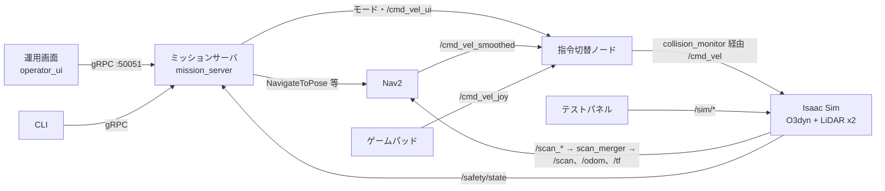

# navigation_ws — セミヒューマノイド ロコモーション開発環境

セミヒューマノイドの移動台車（実機はメカナムホイールの全方向移動台車）を、ソフトウェアに詳しくない現場の人でも運用できるようにするソフトウェアの開発ワークスペース。
**Nav2** を移動の土台にし、その上に自社の **ミッションサーバ**（gRPC API）と **運用画面** を載せる。実機がない段階でも進められるよう、**Isaac Sim** 上の全方向移動台車（O3dyn）で実装・検証している。

> **English summary** — Development workspace for the locomotion software of a semi-humanoid mobile base (mecanum, omnidirectional).
> A Python mission server exposes a gRPC API (task commands by point or route, pause/resume, safety stop, teleop) on top of ROS 2 Jazzy / Nav2,
> and a PySide6 operator UI talks only to that API. Everything runs against an omnidirectional robot (O3dyn) in NVIDIA Isaac Sim 6.1,
> with a separate test panel to inject faults (safety stop, sensor/drive failure, robot warp). Documentation is in Japanese.

## 現在の状況

| 段階 | 状態 |
|---|---|
| 開発環境（Isaac Sim + Nav2 + ゲームパッド + テストパネル） | 完了 |
| ミッションサーバ（状態遷移・ROS 2 接続・gRPC API・CLI） | 完了（テスト 149 件） |
| 運用画面（PySide6） | 試作済み・動作確認の途中 |
| 地図作成（SLAM）、異常の分類と復旧、セットアップ機能、製品化 | 未着手 |

最新の状況・次の作業・未解決の課題は [doc/roadmap.md](doc/roadmap.md) の冒頭と [doc/notes.md](doc/notes.md) にある。

## 文書の案内

| 文書 | 内容 |
|---|---|
| [doc/handover.md](doc/handover.md) | **最初に読む**。全体像、読む順番、設計の判断の経緯、次の作業（開発を引き継ぐ人向け） |
| [doc/locomotion_spec.md](doc/locomotion_spec.md) | 機能仕様（**正**）。状態遷移表（4 章）と異常の分類（5 章）が設計の中心 |
| [proto/locomotion/v1/locomotion.proto](proto/locomotion/v1/locomotion.proto) | gRPC API（メッセージの詳細はこれが**正**） |
| [doc/roadmap.md](doc/roadmap.md) | 開発の段階と進捗、現在の状況と再開手順 |
| [doc/notes.md](doc/notes.md) | 未解決の課題と、解決済みの知見（ハマりどころ） |
| [doc/ui_screens.md](doc/ui_screens.md) | 運用画面の画面構成と決定事項 |

## 必要なもの

| 項目 | 要件（括弧内は開発に使った環境） |
|---|---|
| OS | Ubuntu 24.04 LTS（22.04 からのアップグレード手順あり） |
| GPU | NVIDIA RTX（RT コア必須）、VRAM 16 GB 以上を推奨（RTX 3090 Ti 24 GB） |
| NVIDIA ドライバ | 595.58.03 以上（Isaac Sim 6.x の要件） |
| メモリ | 32 GB 以上（64 GB） |
| ディスク | 空き 100 GB 以上（Isaac Sim 約 27 GB + ダウンロード 13 GB ほか） |
| その他 | sudo 権限、インターネット接続、ゲームパッド Logicool F310（任意） |

## セットアップ

```bash
git clone https://github.com/HiroshiKumagai/navigation_ws.git ~/future_ws/navigation_ws
cd ~/future_ws/navigation_ws

./dev_setting/01_upgrade_to_noble.sh        # Ubuntu 22.04 の場合のみ（24.04 なら 02 から）
./dev_setting/01b_post_upgrade_fix.sh       #   同上。アップグレード後の外部リポジトリ・パッケージの整理
./dev_setting/02_install_ros2_jazzy.sh      # ROS 2 Jazzy（desktop）
./dev_setting/03_install_turtlebot3_sim.sh  # TurtleBot3 + Gazebo。Nav2 一式・slam_toolbox もここで入る
./dev_setting/04_update_nvidia_driver.sh    # NVIDIA ドライバ 595 系 → 実行後に再起動
./dev_setting/05_install_isaac_sim.sh       # Isaac Sim 6.1.0 → ~/isaacsim（約 13 GB のダウンロード）
./dev_setting/06_setup_python_env.sh        # .venv（PySide6・grpcio ほか）、gRPC コード生成、サーバ・運用画面の登録

source /opt/ros/jazzy/setup.bash
colcon build --symlink-install              # ROS 2 パッケージ（src/o3dyn_navigation）
```

動作確認:

```bash
cd mission_server && ../.venv/bin/python -m pytest -q && cd ..   # 149 passed（ROS 2・Isaac Sim なしで動く）
./start_sim.sh --all                                              # 次節。運用画面で「ホーム」を設定して待機になれば正常
```

Git に入っておらず、上の手順で作られるもの: `.venv/`、`mission_server/gen/`（proto の生成コード）、`build/` `install/` `log/`、`.claude/skills/`、`~/isaacsim`。

## 起動と終了

```bash
./start_sim.sh --all    # Isaac Sim → Nav2・rviz2・ゲームパッド → ミッションサーバ・テストパネル・運用画面。Ctrl+C で全て終了
./stop_sim.sh           # 別のターミナルから全て終了（途中で残ったプロセスもまとめて止める）
```

| オプション | 起動するもの |
|---|---|
| （なし） | Isaac Sim と Nav2 のみ |
| `--server` / `--panel` / `--ui` | ミッションサーバ / テストパネル / 運用画面（`--ui` は `--server` も有効にする） |
| `--all` | `--server --panel --ui` |
| `--headless` / `--no-nav` / `--no-rviz` / `--no-joy` | Isaac Sim を画面なしで / Isaac Sim のみ / rviz2 なし / ゲームパッドなし |

- 初回は Isaac Sim のシェーダのコンパイルで起動に数分かかる
- ログは `log/sim/`（Isaac Sim、ミッションサーバ、テストパネル、運用画面）
- `ROS_DOMAIN_ID` は既定で **42**（同じネットワークの他の ROS 2 ノードと混ざらないように）。別のターミナルから ROS 2 を触るときは次を実行する

```bash
source /opt/ros/jazzy/setup.bash && source ~/future_ws/navigation_ws/install/setup.bash && export ROS_DOMAIN_ID=42
```

## 使い方

### 運用画面
`./start_sim.sh --all` で起動する（単体なら `.venv/bin/python -m locomotion_ui [--role operator|integrator]`）。
画面は「共通ヘッダ（状態・停止ボタン）」「地図」「右側のパネル」で構成される（詳細は [doc/ui_screens.md](doc/ui_screens.md)）。

1. **初期位置を設定する**: 起動直後は「準備未完了」で、右側に対応パネルが出る。［地点で設定］で「ホーム」を選ぶ（または地図をタップ・ドラッグして［この位置に設定］）→「待機」になる
2. **移動を指示する**: ルート（北側の巡回・南側の巡回）を押す、または地点を押した順に並べて［移動開始］。進捗は ✓（到着済み）/ ▶（移動中）/ ✕（失敗）で表示される
3. **止める**: ヘッダの［一時停止］（押すと［再開］に変わる）・［停止］はいつでも同じ場所にある
4. **異常のとき**: 異常停止・安全停止になると、右側に「何が起きたか・何をするか・押すボタン」が自動で出る

### 手動操作（ゲームパッド・操作パッド）
1. 運用画面のモード欄で **ジョイスティックモード** を選ぶ（待機・準備未完了・異常停止のときに切り替えられる）
2. 運用画面の右側に出る **操作パッド**（移動はドラッグ、旋回は押している間だけ）か、**ゲームパッド** で動かす。両方を同時に使うとゲームパッドが優先される
3. 戻すときはモード欄で **UI 指示モード** を選ぶ

| ゲームパッド（Logicool F310、背面スイッチは X） | 割り当て |
|---|---|
| 動かす（押している間だけ） | **LB を押しながら**スティック |
| 前後 / 横移動 | 左スティック 上下 / 左右 |
| 旋回 | 右スティック 左右 |
| 高速（0.5 m/s） | LB + RB |

モードはミッションサーバが管理しているので、サーバが動いているときは必ず運用画面か CLI（`mode joystick`）で切り替える。

### テストパネル（異常の再現）
製品の UI とは別の、シミュレーション専用の画面（`--panel` で起動）。地図に真値（青）と AMCL の推定（橙）、推定誤差も表示される。

| 操作 | 再現されること | ミッションサーバから見えるもの |
|---|---|---|
| 安全系: 保護停止 | 台車が速度指令を受け付けない | `/safety/state` = 1 |
| 安全系: 非常停止 | 同上。スイッチを戻しても解除されず、リセットが必要 | `/safety/state` = 2 |
| 機器異常: LiDAR 左前 / 右後 | その LiDAR の配信が止まる | スキャンの途絶 |
| 機器異常: 台車ドライバ | 速度指令を受け付けず、`/odom`・`/joint_states` が止まる | オドメトリの途絶 |
| ワープ | 地図で指定した姿勢へ瞬間移動。`/odom` は追従しない | 自己位置喪失 |

### CLI（API の動作確認）
運用画面と同じく gRPC API だけを使うクライアント。`.venv/bin/python -m mission_server.cli [--role operator|upper-system|integrator] <コマンド>`

| コマンド | 内容 |
|---|---|
| `status` / `watch` / `pose` | 状態 / 状態の変化を表示し続ける / 位置・速度を表示し続ける |
| `init-pose POINT_ID` / `init-pose --pose X Y YAW_DEG` | 初期位置の設定 |
| `go POINT_ID ...` / `go --route ROUTE_ID` | 移動指示（複数の地点なら巡回） / ルートで移動指示 |
| `pause` / `resume` / `stop` / `retry` | 保持中のタスクへの操作 |
| `mode upper\|operator\|joystick` | モード切替 |
| `reset-safety` | 非常停止のリセット |
| `points` / `routes` / `tasks` / `task ID` | 地点・ルート・実行記録の一覧 / 実行記録の詳細 |
| `add-point ID [--pose X Y YAW_DEG]` | 地点の登録（`--pose` 省略時は現在位置。`--role integrator`） |

役割は gRPC の metadata `x-locomotion-role` で渡す（本番では Envoy が認証結果を入れる想定）。

### 開発用ツール（ミッションサーバを通さないデバッグ用）
以下は ROS 2 や Isaac Sim を直接操作する。**ミッションサーバが動いているときに使うと、サーバが把握している状態と食い違う**ので、サーバなし（`./start_sim.sh` のみ）で使う。

| ツール | 用途 |
|---|---|
| rviz2 の「Nav2 Goal」、`python3 sim/tools/send_goal.py X Y [YAW_DEG]` | Nav2 に直接目標を送る |
| `ros2 service call /cmd_vel_switch/set_joystick_mode std_srvs/srv/SetBool "{data: true}"` | 指令切替ノードを直接ジョイスティックモードにする |
| `python3 sim/tools/check_omni_motion.py` | 前進・横移動・旋回の指令で全方向移動を確認（Nav2 なし） |
| `python3 sim/tools/set_initial_pose_from_sim.py` | シミュレーションの真値を AMCL の初期位置として送る |
| `.venv/bin/python mission_server/tools/try_with_sim.py` | ミッションサーバの中核と ROS 2 接続を直接つないだ結合試験 |
| `~/isaacsim/python.sh sim/tools/generate_map.py --output <パス>` | Isaac Sim の環境から Nav2 用の地図を生成 |
| `~/isaacsim/python.sh sim/tools/inspect_usd.py <USD>` | USD のセンサ・関節・OmniGraph を一覧表示 |

## 構成



UI と CLI は gRPC API だけを使い、ROS 2 には触れない。ROS 2 の詳細はミッションサーバの中に閉じ込めている（理由は [doc/handover.md](doc/handover.md) 7 章）。

| パス | 内容 |
|---|---|
| `doc/` | 仕様書、引き継ぎ資料、ロードマップ、課題、画面構成 |
| `proto/locomotion/v1/` | gRPC API の定義 |
| `mission_server/` | ミッションサーバ（`.venv` で動く Python パッケージ） |
| 　`mission_server/mission_server/core/` | 状態遷移とタスク管理の中核（ROS 2 にも gRPC にも依存しない） |
| 　`mission_server/mission_server/ros_adapter.py` | ROS 2 との接続（Nav2・AMCL・安全系・指令切替ノード・map_server） |
| 　`mission_server/mission_server/grpc_api/` | gRPC サービス（Robot / Task / Map / Point） |
| 　`mission_server/mission_server/store.py` | 地図・地点・ルート・設定の保存（`data/`） |
| 　`mission_server/mission_server/cli.py`、`mission_server/tools/` | CLI と結合試験 |
| 　`mission_server/tests/` | テスト（遷移表の各行 `test_transitions.py`、規則 `test_rules.py`、API `test_grpc_api.py`） |
| `operator_ui/` | 運用画面（PySide6、パッケージ `locomotion_ui`） |
| `src/o3dyn_navigation/` | ROS 2 パッケージ（colcon）: Nav2 の設定、scan_merger、指令切替ノード、起動ファイル |
| `sim/` | Isaac Sim 側: シーン構築 `o3dyn_bringup.py`、異常再現 `sim_test_hooks.py`、テストパネル `test_panel.py`、`tools/` |
| `data/` | 地図・地点・ルート・ロボット設定（倉庫の地図、地点 home・A〜D、ルート north・south） |
| `dev_setting/` | 環境構築スクリプト |
| `scripts/gen_proto.sh` | proto から gRPC のコードを生成 |
| `start_sim.sh` / `stop_sim.sh` | 環境の一括起動・終了 |

## 開発の流れ

- **仕様書が正**。仕様を変えるときは、仕様書 → proto → `scripts/gen_proto.sh` → 中核とテスト → サーバ・運用画面 の順に直す
- テスト: `cd mission_server && ../.venv/bin/python -m pytest -q`
- 課題や知見は [doc/notes.md](doc/notes.md) に、進捗は [doc/roadmap.md](doc/roadmap.md) のチェックボックスに残す

## リファレンス: ROS 2 インタフェース

シミュレーションが提供するもの（実機でも同じにする前提。仕様書 9 章）:

| トピック | 型 | 内容 |
|---|---|---|
| `/cmd_vel`（購読） | `geometry_msgs/Twist` | 台車への速度指令（`linear.x`, `linear.y`, `angular.z`） |
| `/odom` | `nav_msgs/Odometry` | `odom` → `base_link` |
| `/tf`、`/tf_static` | | `odom` → `base_link`、`base_link` → `lidar_front_left` / `lidar_rear_right` |
| `/scan_front_left`、`/scan_rear_right` | `sensor_msgs/LaserScan` | 2D LiDAR（360°、0.05〜40 m、10 Hz） |
| `/joint_states` | `sensor_msgs/JointState` | 全関節 |
| `/clock` | `rosgraph_msgs/Clock` | シミュレーション時刻（ROS 側は `use_sim_time: true`） |
| `/safety/state` | `std_msgs/UInt8` | 安全系の状態 0=正常、1=保護停止、2=非常停止（transient local）。**実機の安全 PLC の仕様が決まるまでの暫定** |
| `/safety/reset`（購読） | `std_msgs/Empty` | 非常停止のリセット |

試験用（テストパネルが使う。ミッションサーバは使わない）:

| トピック / サービス | 型 | 内容 |
|---|---|---|
| `/sim/safety_switch`（購読） | `std_msgs/UInt8` | 模擬安全スイッチ 0=解除、1=保護停止、2=非常停止 |
| `/sim/fault/{lidar_front_left, lidar_rear_right, drive}` | `std_srvs/SetBool` | 機器異常の ON/OFF |
| `/sim/warp`（購読） | `geometry_msgs/PoseStamped` | map 座標の姿勢へ瞬間移動 |
| `/sim/ground_truth` | `nav_msgs/Odometry` | 真値（map → base_link） |
| `/sim/status` | `std_msgs/String` | 試験用の状態（JSON） |

座標系: Isaac Sim のワールド座標 = `map` フレーム。ロボットはワールド原点に置かれる。

## シミュレーションの前提と既知の制約

| 項目 | 内容 |
|---|---|
| 台車 | Isaac Sim 付属の O3dyn（Fraunhofer IML。約 2.07 × 1.48 m、全方向移動）。実機はメカナム台車 |
| ホイール制御 | 付属の HolonomicController は速度が約 1/3・旋回が逆符号になるため使わず、メカナムの逆運動学を自前で計算 |
| LiDAR | 左前・右後ろの角に 1 台ずつ。SICK nanoScan3 のモデルはスキャンが約 3 割欠けるため、回転型 2D LiDAR で代用 |
| オドメトリ | シミュレーションの真値（ワープ分は除く）。実機のホイールオドメトリの誤差は再現していない |
| 速度指令 | シミュレーションは `/cmd_vel` の最後の値を保持する。停止は指令切替ノードのタイムアウト（0.5 秒）に頼っている |
| 地図 | 倉庫シーン（Simple_Warehouse）の当たり判定から生成。`data/maps/warehouse/` と `src/o3dyn_navigation/maps/` の 2 か所にある（一本化は予定）。広く特徴が少ないため、左側で AMCL が x 方向に最大 0.4 m ほどずれる |
| 速度上限 | 台車 2.0 m/s（仮）、Nav2 0.5 m/s、ゲームパッド・操作パッド 0.3 m/s（ゲームパッドの高速 0.5 m/s） |

## トラブルシューティング

| 症状 | 対処 |
|---|---|
| 起動時に「ポート 50051 を使えません」 | ミッションサーバが残っている。`./stop_sim.sh` で全て止めてから起動し直す |
| ROS 2 のトピックが見えない | `ROS_DOMAIN_ID` が 42 か確認。Isaac Sim は再生（Play）中のみ配信する |
| 運用画面・テストパネルが「Could not load the Qt platform plugin "xcb"」で起動しない | `dev_setting/06_setup_python_env.sh` を実行（`libxcb-cursor0` が必要） |
| Nav2 の起動が「transform from base_link to map」で止まる | ロボットが原点以外にいる状態で Nav2 だけを起動し直したとき。`sim/tools/set_initial_pose_from_sim.py` を実行してから `ros2 service call /lifecycle_manager_navigation/manage_nodes nav2_msgs/srv/ManageLifecycleNodes "{command: 3}"` → `"{command: 0}"` |
| その他 | `log/sim/` のログと、[doc/notes.md](doc/notes.md) の解決済みの知見を確認する |

## ライセンス

ライセンスファイルは置いていない。著作権者がすべての権利を保持しており、閲覧以外の利用（複製・改変・再配布）は許可していない。
Isaac Sim・Nav2 などの依存ソフトウェアは、それぞれのライセンスに従う。
