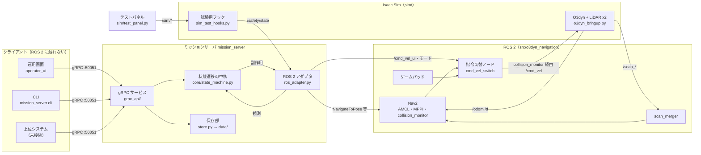

# 引き継ぎ資料

Oct 30, 2026 作成。このリポジトリの開発を引き継ぐ人が、最初に読む文書。
詳細は各文書にあり、ここでは「何を・どの順で読むか」「全体像」「なぜそう作ったか」「次に何をするか」をまとめる。

## 1. 読む順番

| 順 | 文書 | 内容 | 目安 |
|---|---|---|---|
| 1 | この文書 | 全体像、判断の経緯、次の作業 | 30 分 |
| 2 | [locomotion_spec.md](locomotion_spec.md) | **機能仕様（正）**。状態遷移表（4 章）と異常の分類（5 章）が設計の中心 | 1 時間 |
| 3 | [../README.md](../README.md) | 環境、起動方法、ツール、ROS 2 インタフェース、既知の制約 | 20 分 |
| 4 | [roadmap.md](roadmap.md) | 開発の段階と進捗。**冒頭に現在の状況と再開手順** | 10 分 |
| 5 | [notes.md](notes.md) | 未解決の課題と、解決済みの知見（ハマりどころ） | 15 分 |
| 6 | [ui_screens.md](ui_screens.md) | UI の画面構成と決定事項 | 15 分 |
| 7 | [../proto/locomotion/v1/locomotion.proto](../proto/locomotion/v1/locomotion.proto) | gRPC API（メッセージの詳細はこれが正） | 必要に応じて |

## 2. このプロジェクトは何か

セミヒューマノイドの移動台車（実機はメカナムホイールの全方向移動台車）を、ソフトウェアに詳しくない現場の人でも運用できるようにするソフトウェア。

- **Nav2** を移動の土台にし、その上に自社の **ミッションサーバ**（gRPC API）と **UI** を載せる
- UI と上位システム（WMS 等）は API のクライアントで、ROS 2 には触れない
- 実機がない段階でも進められるよう、**Isaac Sim** 上の全方向移動台車（O3dyn）で実装・検証している。仕様と実装はシミュレーションで動かしながら並行して直す方針

## 3. 現在地（Oct 30, 2026）

| 段階 | 状態 |
|---|---|
| 0 開発環境（Isaac Sim + Nav2 + ゲームパッド + テストパネル） | 完了 |
| 1 ミッションサーバ（状態遷移の中核、ROS 2 接続、gRPC API、CLI） | 完了。テスト 149 件 |
| 2 ローカル UI（PySide6） | **途中**。試作はできたが、画面の確認が一部のみ。課題 9 の調査待ち |
| 3 地図作成（SLAM）／4 異常の分類と復旧／5 セットアップ機能／6 製品化 | 未着手 |

最優先の未解決課題: **ルート「北側の巡回」（home から A → B → home）が約 20 秒で「成功」になる**（notes.md 課題 9）。最後の地点が出発地点と同じため、Nav2 の NavigateThroughPoses が早く完了扱いにしている疑い。

## 4. 全体構成



起動すると動くプロセス（`./start_sim.sh --all`）:

| プロセス | 中身 |
|---|---|
| Isaac Sim | `sim/o3dyn_bringup.py`（倉庫シーン、O3dyn、LiDAR、ROS 2 ブリッジ、試験用フック） |
| Nav2 一式 | `ros2 launch o3dyn_navigation navigation.launch.py`（map_server、AMCL、経路計画・追従、scan_merger、指令切替ノード、ゲームパッド、rviz2） |
| ミッションサーバ | `.venv/bin/python -m mission_server`（gRPC :50051） |
| テストパネル | `.venv/bin/python sim/test_panel.py`（異常の再現。製品ではない） |
| 運用画面 | `.venv/bin/python -m locomotion_ui` |

## 5. リポジトリの構成

| パス | 責務 | 主なファイル |
|---|---|---|
| `doc/` | 仕様、計画、課題、画面構成、この資料 | |
| `proto/locomotion/v1/` | gRPC API の定義 | `locomotion.proto` |
| `mission_server/` | ミッションサーバ（Python パッケージ。colcon ではなく `.venv` で動かす） | `core/state_machine.py`（中核）、`ros_adapter.py`、`grpc_api/services.py`、`store.py`、`cli.py`、`tests/` |
| `operator_ui/` | 運用画面（PySide6、パッケージ `locomotion_ui`） | `main_window.py`、`panels.py`、`map_view.py`、`control_pad.py`、`api.py`、`labels.py` |
| `src/o3dyn_navigation/` | ROS 2 パッケージ（colcon でビルド）。Nav2 の設定と自作ノード | `config/nav2_params.yaml`、`scan_merger.py`、`cmd_vel_switch.py`、`launch/navigation.launch.py` |
| `sim/` | Isaac Sim 側（Isaac Sim の python.sh で動く）と開発用ツール | `o3dyn_bringup.py`、`sim_test_hooks.py`、`test_panel.py`、`tools/` |
| `data/` | 地図・地点・ルート・ロボット設定（YAML） | `maps/warehouse/`、`settings.yaml` |
| `dev_setting/` | 環境構築スクリプト（番号順に実行） | `01`〜`06` |
| `scripts/` | コード生成 | `gen_proto.sh` |
| `start_sim.sh` / `stop_sim.sh` | 環境の一括起動・終了 | |
| `.claude/skills/` | Claude Code 用の Isaac Sim スキル（`~/isaacsim/skills` へのリンク。git 管理外で、`06_setup_python_env.sh` が作る） | |

Git に入っていないもの（再生成する）: `.venv/`、`mission_server/gen/`（proto の生成コード）、`build/` `install/` `log/`（colcon）、`.claude/skills/`、Isaac Sim 本体（`~/isaacsim`）。

## 6. 環境構築（ゼロから）

前提: NVIDIA RTX GPU（VRAM 16 GB 以上推奨。開発は RTX 3090 Ti）、メモリ 32 GB 以上、ディスク空き 100 GB 以上、sudo 権限、インターネット接続（Isaac Sim は約 13 GB）。

```bash
git clone https://github.com/HiroshiKumagai/navigation_ws.git ~/future_ws/navigation_ws
cd ~/future_ws/navigation_ws
./dev_setting/01_upgrade_to_noble.sh      # Ubuntu 22.04 の場合のみ。24.04 なら不要
./dev_setting/01b_post_upgrade_fix.sh     # 同上
./dev_setting/02_install_ros2_jazzy.sh
./dev_setting/03_install_turtlebot3_sim.sh  # Nav2 一式もこのとき入る
./dev_setting/04_update_nvidia_driver.sh  # 595 系。実行後に再起動
./dev_setting/05_install_isaac_sim.sh     # Isaac Sim 6.1.0 → ~/isaacsim
./dev_setting/06_setup_python_env.sh      # .venv、gRPC コード生成、mission_server / operator_ui の登録
source /opt/ros/jazzy/setup.bash && colcon build --symlink-install
```

動作確認:

```bash
cd mission_server && ../.venv/bin/python -m pytest -q && cd ..   # 149 passed（ROS 2・Isaac Sim なしで動く）
./start_sim.sh --all                                              # 初回は Isaac Sim のシェーダコンパイルで数分
```

運用画面で「ホーム」を地点で設定 → 待機になれば環境は正常。終了は Ctrl+C か `./stop_sim.sh`。

注意:
- `ROS_DOMAIN_ID` は既定 **42**。開発 PC のネットワークに他の ROS 2 ノード（MoveIt 系）が見えていたため分けている。別のターミナルから ROS 2 を触るときは同じ値にする
- ゲームパッドは Logicool F310（背面スイッチ X）を前提に割り当てている（`src/o3dyn_navigation/config/teleop_f310.yaml`）

## 7. 設計の要点と判断の経緯

コードだけでは分からない「なぜ」をまとめる。詳細は仕様書・notes を参照。

### アーキテクチャ
| 判断 | 理由 |
|---|---|
| ROS 2 の詳細はミッションサーバの中に閉じ込め、UI・上位システムは gRPC だけを使う | UI をブラウザ版に入れ替えるとき、上位システムと接続するときに ROS 2 を意識させないため（仕様書 2 章） |
| 中核（`core/`）は ROS 2 にも gRPC にも依存させず、状態遷移を表（`ACCEPTED_STATES`）として持つ | 遷移表の各行をそのまま単体テストにできる（`tests/test_transitions.py` のテスト名の番号 = 表の行） |
| 中核は ROS 2 を直接呼ばず「副作用（Effect）」を出し、アダプタがキュー経由で ROS 2 のスレッドで実行する | 中核のロックを持ったまま ROS 2 を呼ぶとデッドロックするため |
| Nav2 の結果は目標ごとの連番（goal_seq）で突き合わせる | 一時停止などでキャンセルした古い目標の結果を誤って反映しないため |
| ミッションサーバは Python | 仕様とコードを並行して直す段階で、試行錯誤の速さを優先 |
| gRPC サーバはポート共有（SO_REUSEPORT）を禁止 | 同じポートで 2 つ目のサーバが起動し、リクエストが新旧に振り分けられる事故があったため |

### 仕様に関する決定（会話の中で決めたもの）
| 決定 | 内容・理由 |
|---|---|
| 安全系の信号 | 暫定で `/safety/state`（UInt8: 0=正常, 1=保護停止, 2=非常停止）、リセットは `/safety/reset`。実機の安全 PLC の仕様が決まったら見直す |
| 実装で見つかった遷移の補足 | 待機中の自己位置喪失は準備未完了へ、など（仕様書 4 章「実装上の要点」）。自己位置を喪失したまま待機にすると、初期位置を設定し直せず行き詰まるため |
| 操作パッド（Teleop API） | UI 上でゲームパッド相当の手動操作を可能にする。UI は ROS 2 に触れない原則のため API 経由。ゲームパッドと同時なら、ゲームパッドを優先する |
| ルート | 地点 ID の並びに名前を付けて保存。1 つの地図に複数。ルート ID で移動指示できる |
| UI はまず PySide6 のローカルアプリ | 最終的にはタブレットのブラウザ。API のクライアントに徹しているので画面だけ置き換えられる |
| 異常の再現は別の UI（テストパネル） | 製品の UI に試験用の機能を混ぜないため |
| 地図作成を前倒し | 現場への導入で最初に行う作業のため（ジョイスティックモードで走行しながら作る） |

### シミュレーションの工夫（実機と違う点）
| 点 | 内容 |
|---|---|
| 台車 | Isaac Sim 付属の O3dyn。付属の制御部品は速度が約 1/3・旋回が逆になるため、メカナムの逆運動学を自前で計算 |
| LiDAR | SICK nanoScan3 のモデルはデータが約 3 割欠けるため、回転型 2D LiDAR で代用 |
| オドメトリ | 真値を使う。ただし試験用のワープでは動かさない（自己位置喪失を再現するため）。真値は `/sim/ground_truth` |
| 地図 | Isaac Sim の当たり判定から生成（`sim/tools/generate_map.py`）。生成拡張の画像は x 反転しているので注意 |

## 8. 開発の進め方

- **仕様書が正**。仕様を変えるときは、仕様書 → proto → `scripts/gen_proto.sh` → 中核とテスト → サーバ・UI の順に直す
- テスト: `cd mission_server && ../.venv/bin/python -m pytest -q`（ROS 2 の pytest プラグインは pytest 9 と互換がないため無効化している）
- シミュレーションでの結合試験: `mission_server/tools/try_with_sim.py`（中核 + ROS 2 アダプタを直接つなぐ）、`python -m mission_server.cli`（API 経由）
- 課題や知見は [notes.md](notes.md) に、進捗は [roadmap.md](roadmap.md) のチェックボックスに残す
- コミットは機能のまとまりごと。メッセージは英語、本文に変更点の箇条書き

## 9. 次にやること

[roadmap.md](roadmap.md) の冒頭「現在の状況」と同じ。

1. **課題 9 の調査**: `./start_sim.sh --all` → 運用画面で「ホーム」を設定 → ルート「北側の巡回」を開始し、Nav2 のログとフィードバック（number_of_poses_remaining）を確認する
2. 運用画面の残りの確認: 移動中の進捗表示（✓ / ▶）、安全停止・異常停止の対応パネル（テストパネルで再現）、操作パッドでの手動操作、実行記録
3. ステップ 2 を仕上げてコミット → ステップ 3（地図作成: slam_toolbox の組み込み）へ

並行して決める必要があること（roadmap.md 末尾）: 安全系の実機仕様、安全停止中の停止指示の扱い、状態配信の周期、上位システムへの通知形式。

## 10. 引き継ぎで確認すること

- [x] リポジトリの公開: https://github.com/HiroshiKumagai/navigation_ws（Public、ブランチ master。ライセンスファイルなし）
- [ ] 開発 PC の要件を満たす環境（GPU・ドライバ 595 以上）と sudo 権限
- [ ] Isaac Sim 6.1.0 のダウンロード（約 13 GB）と利用条件の確認
- [ ] ゲームパッド（Logicool F310）
- [ ] 6 章の手順で環境を作り、テストと `./start_sim.sh --all` が動くこと
- [ ] 仕様書の未決事項（10 章）と notes.md の未解決課題の担当
- [ ] Claude Code で開発する場合: `.claude/skills/` は `06_setup_python_env.sh` が `~/isaacsim/skills`（または `$ISAACSIM_PATH/skills`）へのリンクとして作る。前任者の Claude Code のメモリ（会話の記憶）は引き継がれないため、判断の経緯はこの文書と仕様書を参照する
