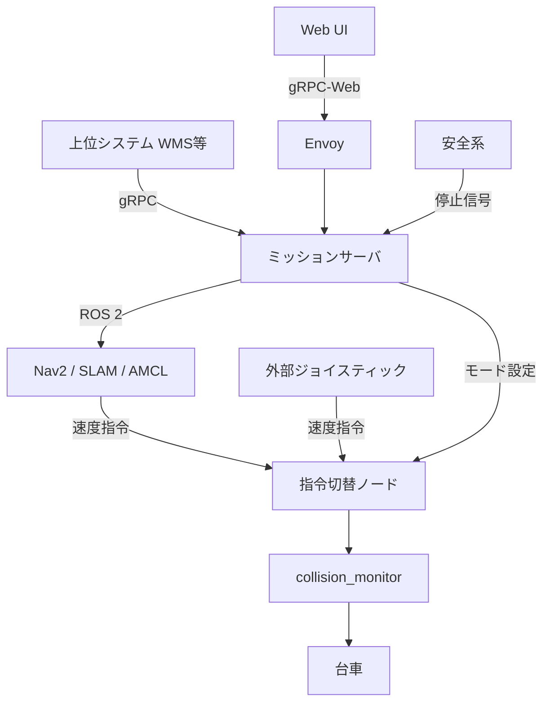
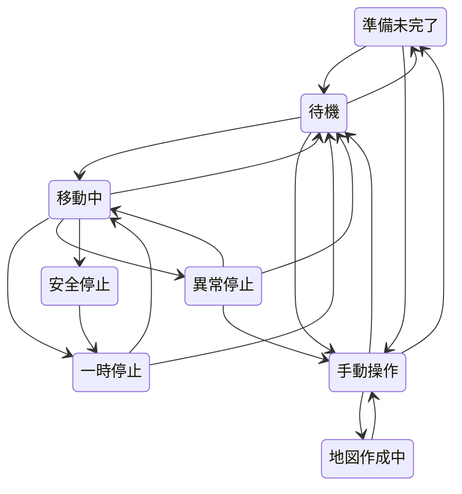

# セミヒューマノイド ロコモーション ソフトウェア仕様（たたき台）

Sep 24, 2026 · @hiroshi（Sep 25, 2026 改訂：状態遷移とタスク結果の整理）

## 1. 概要とスコープ

Nav2の機能を流用し、その上に自社開発のミッションサーバとUIを置いて、ソフトウェアリテラシーの高くない現場ユーザでも移動台車を運用できるようにする。本書はその機能仕様のたたき台であり、シミュレーション上で実装・検証しながら改訂する前提とする。

**対象範囲**

- 地図の作成・登録・編集、目標地点の登録
- 地点IDを用いた移動指示（UIおよび上位システムから）
- ロボットのナビゲーション状態の管理、異常の分類と復旧
- 上記を公開するgRPC API、およびそのクライアントとしてのWeb UI

**対象外**

- 上半身の制御（移動と作業は当面分離して扱う）
- 安全系そのもの（セーフティLiDAR・安全PLC等）。本書は安全系からの停止信号の受け取り方のみを扱う
- 複数台の協調運用・フリート管理

## 2. システム構成

UIと上位システムはどちらもミッションサーバのgRPC APIのクライアントであり、ROS 2には直接触れない。ROS 2の詳細はサーバの内側に閉じ込める。

**ミッションサーバの責務**

- 地図IDと地点IDの管理と永続化
- 地点IDの指示をNav2のNavigateToPose／NavigateThroughPosesに翻訳して実行
- 一時停止・再開（Nav2に機能がないため、目標をキャンセルして保持・再送する）
- 指示権（モード）の調停と役割ベースの権限判定
- Nav2の状態・エラーを、ユーザに意味のある状態と異常の分類に翻訳
- 各ノードの死活監視と、安全系からの停止信号の受け取り

**構成上の決定事項**

- 外向きAPIはgRPC。ブラウザはEnvoy経由のgRPC-Webで接続し、上位システムはネイティブgRPCで直接接続する。gRPC-Webはunaryとサーバストリーミングのみ使用可能
- ジョイスティックの指令はAPIを経由せず、外部からROS 2に直接入る。APIが扱うのは受付の可否（モード）のみ
- Nav2とジョイスティックの速度指令は別トピックに出し、指令切替ノードがモードに応じて一方だけを通す。ジョイスティック指令が途絶えたら停止する機能も持たせる
- 指令切替ノードはcollision\_monitorの手前に置き、手動操作にも減速・停止を効かせる
- Nav2のBehavior Treeは自社が設計して製品に組み込む。UIからは用意済みのBT（移動モード）を地点ごとに選ぶだけとし、編集は開放しない
- エリアごとの速度制限・立入禁止はNav2のコストマップフィルタで実現する

## 3. モードと権限

モードは3つで、切り替えは準備未完了・待機・異常停止・手動操作のときのみ許可する（一時停止・安全停止・地図作成中・移動中は不可）。停止・一時停止はモードに関係なく常にオペレータが出せる。

| モード | 移動指示の受付元 | 速度指令の出口 |
| --- | --- | --- |
| 上位指示モード | 上位システム | Nav2 |
| UI指示モード | オペレータ（UI等） | Nav2 |
| ジョイスティックモード | なし（ナビゲーション無効） | 外部ジョイスティック |

**権限**

UIでできる操作はすべてgRPC APIで公開し、別アプリからも実行できる。そのため可否はクライアントの種類ではなく役割で判定する。認証はEnvoyで受け、役割に応じた判定はサーバで行う。

| 役割 | できること |
| --- | --- |
| 上位システム | 上位指示モード中の移動指示、自身が出したタスクの停止 |
| オペレータ | 停止・一時停止・再開（常時）、UI指示モードでの移動指示、異常からの復旧操作、モード切替 |
| 導入担当者 | オペレータの操作に加え、地図・地点・エリアの編集、しきい値等の設定 |

一時停止・再開は「人が止めたものは人が再開する」を基本とし、上位指示モード中でもオペレータが操作できる。

## 4. 状態モデル

ロボットのナビゲーション状態は8つ。モード（誰が指示するか）とは別の軸として管理し、タスクの結果は状態ではなく実行記録に残す。

**タスクの結果**

| 結果 | 条件 |
| --- | --- |
| 成功 | 指定したすべての地点に到達した |
| 中断 | 移動中・一時停止から停止指示で破棄した |
| 失敗 | 異常停止から復旧せずに破棄した（停止指示、初期位置の再設定、ジョイスティックモードへの切替） |

移動中以外からの安全停止と、そこからの復帰は、図を簡潔にするため省略している（遷移表を参照）。

**状態一覧**

| 状態 | 意味 |
| --- | --- |
| 準備未完了 | 地図または自己位置が未確定 |
| 待機 | 停止中で指示待ち |
| 移動中 | Nav2で実行中。表示属性として「通常」「回避動作中」を持つ |
| 一時停止 | 停止しているがタスクを保持している |
| 異常停止 | 移動に失敗し、タスクを保持したまま復旧を待っている |
| 安全停止 | 安全系により停止させられている。種別として保護停止・非常停止を持つ |
| 手動操作 | ジョイスティックの指令を受け付けている |
| 地図作成中 | SLAMを動かしながら手動操作で地図を作っている |

**遷移表**

| 遷移元 | 遷移先 | 条件 |
| --- | --- | --- |
| 準備未完了 | 待機 | 地図の有効化と初期位置の設定 |
| 待機 | 移動中 | 移動指示（現在のモードの指示元から） |
| 移動中 | 待機 | 目標に到達（結果は「成功」）、または停止指示（結果は「中断」） |
| 移動中 | 一時停止 | 一時停止指示 |
| 一時停止 | 移動中 | 再開指示 |
| 一時停止 | 待機 | 停止指示（タスクを破棄、結果は「中断」） |
| 移動中 | 異常停止 | 異常の検知（5章） |
| 異常停止 | 移動中 | 再試行（保持していたタスクを再送） |
| 異常停止 | 待機 | 初期位置の再設定、または停止指示（タスクを破棄、結果は「失敗」） |
| 移動中 | 安全停止 | 安全系からの停止信号 |
| 安全停止 | 一時停止 | 移動中から入った場合の、停止信号の解除（非常停止はリセット操作も必要） |
| 移動中以外のすべて | 安全停止 | 安全系からの停止信号 |
| 安全停止 | 元の状態 | 移動中以外から入った場合の、停止信号の解除（非常停止はリセット操作も必要） |
| 準備未完了／待機 | 手動操作 | ジョイスティックモードへの切替 |
| 異常停止 | 手動操作 | ジョイスティックモードへの切替（タスクを破棄、結果は「失敗」） |
| 手動操作 | 待機 | ナビゲーションモードへの切替（自己位置が正常な場合） |
| 手動操作 | 準備未完了 | ナビゲーションモードへの切替（地図が未選択、または自己位置を喪失している場合） |
| 手動操作 | 地図作成中 | 地図作成の開始（新規、または既存地図IDの再スキャン） |
| 地図作成中 | 手動操作 | 保存、または破棄 |
| 準備未完了／待機 | 準備未完了 | 使用する地図の切替 |

**実装上の要点**

- 回避動作中：Nav2の移動フィードバックに含まれるリカバリ回数の増加で検知する。Nav2のリカバリは行き詰まったときの回転・後退・待機であり、通常の障害物回避とは別物であることを踏まえて表示文言を決める
- 一時停止中はモード切替を不可とする。切り替える場合は停止してタスクを破棄し、待機に戻ってから行う。異常停止中はモード切替を許可し、保持していたタスクは破棄する（結果は「失敗」）
- 導入直後のロボットは地図がないため準備未完了から始まる。最初の地図は、準備未完了からジョイスティックモードに切り替え、手動操作から地図作成を開始して作る
- 安全停止はNav2の失敗から推測せず、安全系の信号で判定する。移動中に信号を受けたら直ちにNav2の目標をキャンセルし、タスクはサーバ側で保持する（一時停止と同じ仕組み）。キャンセルしないとNav2が進捗なしと判断して失敗扱いにし、異常停止へ誤って遷移する
- 移動中からの安全停止は、解除後に自動で再開せず一時停止へ落とし、人が再開する。それ以外の状態からの安全停止は、解除後に元の状態へ戻る
- 地図作成中の安全停止ではSLAMを止めない。解除後は地図作成中に戻り、作りかけの地図を継続する
- 安全停止中のタスクの状態は、安全停止に入る前の値を保つ。ただし移動中から入った場合は一時停止扱いとする
- 地図作成中はナビゲーションとAMCLを無効にする。保存時はSLAMの最終推定位置を新しい地図の初期位置として引き継ぐ（その後の手動操作からの戻りで待機へ）。破棄時は自己位置を喪失した扱いになる（準備未完了へ）
- 自己位置の良否はAMCLの推定のばらつきをしきい値で判定する。しきい値は全体の既定値を持ち、地図ごとに上書きできる。UIでは「厳しめ／標準／緩め」の段階で見せ、変更は導入担当者に限る

## 5. 異常の分類と復旧手順

異常はNav2内部の原因ではなく、現場の人が何をすべきかで4つに分類する。

| 分類 | 典型的な原因 | 現場での対処 | 復旧操作 |
| --- | --- | --- | --- |
| 経路閉塞 | 障害物で通れず、リカバリも尽きた | 障害物をどける | 再試行／タスク破棄 |
| 目標到達不能 | 目標地点が障害物上、または立入禁止エリア内 | 地点の設定を見直す | タスク破棄 |
| 自己位置喪失 | 周囲の景色が変わった、人に押された | 初期位置を再設定、または手動で既知の場所へ移動 | 初期位置再設定／手動操作へ切替 |
| 機器異常 | センサ・台車ドライバの停止、通信断 | 現場では直せない | 再起動／サポート連絡 |

- APIで返す異常情報は「分類」と「詳細」の二段構えとする。分類はUI表示と復旧操作の選択に、詳細（Nav2のエラーコード等）はログとサポートに使う
- 異常停止中もタスクを保持する。再試行により、上位指示モードのタスクも途切れずに継続できる
- 機器異常はNav2の結果ではなく、サーバによる各ノードの死活監視で検知する。Nav2の結果だけに頼ると、センサ停止を経路閉塞と誤分類する

## 6. データモデル

地図と地点のIDが、上位システムとのインタフェースの契約になる。上位システムはNav2の座標ではなく地点IDで指示する。

| 実体 | 主な属性 |
| --- | --- |
| 地図 | 地図ID、名称、版番号、地図本体（占有格子と、追加スキャン用のSLAMデータ）、自己位置判定しきい値（任意、既定値の上書き） |
| エリア | 所属地図ID、多角形、種別（立入禁止／速度制限とその値） |
| 地点 | 所属地図ID、地点ID（地図内で一意）、名称、姿勢（x, y, 向き）、移動モード（BTの選択）、到達許容誤差、種別（作業／待機／充電等） |
| 実行記録 | タスクID、指示元、対象地点、状態の履歴、結果、異常の分類と詳細 |
| ロボット設定 | 使用中の地図ID、モード、自己位置判定しきい値の既定値 |

**地図の上書き・複製のルール**

- 編集による上書き（ノイズ除去、エリアの修正）：座標系が変わらないため、地点はそのまま引き継ぐ
- 再スキャンによる上書き：地図の原点・向きがずれる可能性があるため、地点を「再確認が必要」の扱いにする
- 上書きのたびに版番号を上げ、過去の版に戻せるようにする。版番号の対象は地図本体とエリアとし、地点は地点ごとに版を持つ（地図を巻き戻しても地点は巻き戻らない）
- 複製：別の地図IDで地図を複製し、地点は同じ地点IDのままコピーする。これにより、似た地図に切り替えても上位システムは同じ地点IDで指示できる

**その他の方針**

- エリアは多角形で保持し、地図を有効化するときにNav2のフィルタ用マスク画像を生成する
- 実行記録は最初から残す。テスト結果の確認と異常の原因調査に使う
- 複数フロアは地図IDを分けることで将来対応できるため、当面は考慮しない

## 7. UI機能構成

UIの機能は、セットアップ・運用・保守の3層で構成する。画面の詳細はAPI定義の後に決める。

| 層 | 機能 | 内容 |
| --- | --- | --- |
| セットアップ | ① 地図の登録 | 地図作成（生成中の地図のリアルタイム表示、保存・破棄）、ノイズ除去、立入禁止・速度制限エリアの設定 |
| セットアップ | ② 目標地点の登録 | 地図上のクリック、またはティーチング（手動で連れて行き現在位置を記録）。移動モードと到達許容誤差を設定 |
| セットアップ | ③ テスト | 単発の移動・巡回の実行と、登録地点への到達可否の一覧確認 |
| 運用 | ④ 監視・指示 | ロボットの位置・状態の表示、UI指示モードでの移動指示、停止・一時停止・再開、モード切替 |
| 保守 | ⑤ 異常時の復旧 | 異常の分類の表示と、分類ごとの復旧操作（再試行、初期位置再設定、手動操作へ切替等） |
| 保守 | ⑥ 地図・地点の更新 | 地図の上書き・複製、再スキャン後の地点の再確認、版の巻き戻し |

操作端末はタブレットのブラウザを想定する。

## 8. API定義（概要）

gRPC APIは責務と権限の単位で5サービスに分け、パッケージは `locomotion.v1` とする。メッセージの詳細はprotoファイル（[proto/locomotion/v1/locomotion.proto](../proto/locomotion/v1/locomotion.proto)）を正とし、本章は構成と方針のみを記す。

| サービス | 主なRPC | 主な利用者 |
| --- | --- | --- |
| RobotService | GetStatus、WatchStatus、WatchPose、SetMode、SetInitialPose、ResetSafetyStop | 全員（変更操作はオペレータ以上） |
| TaskService | StartTask、PauseTask、ResumeTask、StopTask、RetryTask、GetTask、ListTasks | 上位システム、オペレータ |
| MapService | 地図作成（StartMapping、WatchMappingPreview、SaveMapping、DiscardMapping）、EraseMapRegions、SetAreas、RevertMap、DuplicateMap、DeleteMap、ActivateMap、DownloadMapImage | 導入担当者（ActivateMapはオペレータ以上） |
| PointService | CreatePoint、UpdatePoint、DeletePoint、MarkPointVerified、ListPoints、GetPoint | 導入担当者 |
| ConfigService | GetConfig、UpdateConfig、ListMoveModes、SetMapLocalizationThreshold | 導入担当者 |

**共通方針**

- 指示系のRPCは受理か拒否かだけを即座に返す。進捗はWatchStatusで見る。移動指示をストリームで保持し続ける設計にはしない
- ストリームは2本に分ける。WatchStatusは状態・モード・異常を変化時に配信し、接続直後に現在値を1回送る。連番（sequence）で取りこぼしを検知できる。WatchPoseは位置・速度を周期配信する（既定5Hz）
- 拒否はgRPC標準ステータスで返す。状態が許さない操作はFAILED\_PRECONDITION（現在の状態とモードを詳細に付与）、権限不足はPERMISSION\_DENIED、版の不一致はABORTED、対象なしはNOT\_FOUNDとする。4章の遷移表がそのまま受理・拒否の判定表になる
- StartTaskは要求ID（request\_id）で冪等化し、同じ要求IDの再送では既存のタスクを返す。使用中の地図IDを指定でき、異なる場合は拒否する
- 地図・地点・設定の編集は、期待する版番号（expected\_version）を添えた楽観ロックで行う
- 地図画像は分割してストリームで送る。地図作成中のプレビューは1Hz程度の縮小した全体画像とする

**protoの作成時に決めた事項**

- 単発移動と巡回はStartTaskに統合する。地点IDが1件なら単発、複数なら巡回
- タスクの破棄はStopTaskに統合する。移動中・一時停止・異常停止のいずれからでも待機に戻る。タスクは、移動中・一時停止からなら中断、異常停止からなら失敗として終わる
- 使用する地図を切り替えると準備未完了になる。初期位置は地図上での指定、または登録地点の指定で設定する
- ノイズ除去は、UIが送った多角形の範囲をサーバが空き領域として塗りつぶす方式とする
- 上位システムは、自身が出したタスクに限り停止できる
- 非常停止のリセット（ResetSafetyStop）は暫定的にAPIに含める。要否は安全系の構成を詰める段階で確定する

## 9. 開発・検証方針

Isaac SimとROS 2で構築したシミュレーション環境上の移動台車モデルを使い、本仕様に沿ってサーバとUIを実装する。テストを回しながら仕様とプログラムを並行して修正する。

**シミュレーションでの前提**

- ミッションサーバから見たROS 2のインタフェース（トピック名、座標フレーム、アクション）は、シミュレーションと実機で同一にする。切り替えは起動設定だけで行い、サーバ側のコードに分岐を持たせない
- 実機の台車はメカナムホイール（全方向移動）である。シミュレーションの台車モデルも全方向移動とし、実機に近い外形寸法・最高速度にする。駆動方式が異なると、Nav2のコントローラ設定とチューニング結果を実機に持ち越せない
- 全方向移動に合わせ、Nav2はAMCLのオムニ用運動モデルと、横方向速度を扱えるコントローラ（MPPIのOmniモデル等）で構成する。速度指令は横方向成分を含むため、指令切替ノード・ジョイスティック入力・APIの速度表示もこれを扱う
- シミュレーションに存在しない入力は、模擬ノードで代替する
  - 安全系の停止信号：テスト用のスイッチ（保護停止／非常停止）で発行する。スイッチと以下の異常の再現は、製品のUIとは別のテストパネルから操作する
  - 機器異常：センサや台車ドライバの出力を意図的に止める
  - 自己位置喪失：ロボットを別の場所へワープさせる（オドメトリは追従させない）
  - ジョイスティック：実物のジョイスティック、またはソフトウェアのテレオペで入力する

**テストの進め方**

- 4章の遷移表の各行をそのままテストケースにする。すべての遷移がUIから再現でき、期待した状態になることを確認する
- 5章の異常の4分類は、それぞれ意図的に発生させる手順を用意する（障害物の配置、目標地点を障害物上に置く、ロボットをワープさせて自己位置を失わせる、ノードの停止）

**実機でしか検証できない項目**

- 自己位置判定しきい値の適正値（センサノイズと実環境の特徴量に依存する）
- 目標地点への到達精度
- メカナムホイールの滑りによるオドメトリ誤差（シミュレーションではローラーの接触を忠実に再現しにくい）
- 安全系の実際の挙動と、停止信号がサーバに届くまでの遅延
- 上半身を搭載した状態での加減速特性

## 10. 未決事項と次のステップ

APIの骨格ができたため、次は外部との境界とUIの画面構成に着手する。

- [ ] API定義（proto）：骨格は作成済み（8章）。状態配信の周期と指令への応答時間の目安、シミュレーションでの実装を通じた修正が残る
- [ ] 外部との境界：安全系の停止信号をROS 2に取り込む方式（暫定: `/safety/state`（std_msgs/UInt8、0=正常 1=保護停止 2=非常停止）で受け、非常停止のリセットは `/safety/reset` に出す。実機の安全PLCの仕様が決まったら見直す）、ジョイスティックの入力トピック、上位システムへの通知形式（ストリームで足りるか、イベント通知が要るか）、非常停止のリセットをAPIから出せる必要があるか
- [ ] 安全停止中の操作：安全停止中に停止指示（タスクの破棄）を受け付けるか
- [ ] UIの画面構成：画面一覧と遷移、主要画面のワイヤーフレーム。③テスト画面の中身と、巡回の途中で失敗したときの見せ方もここで決める
- [ ] 非機能要件：地図サイズの上限、同時接続数、データの永続化とバックアップ、ログの保存期間、ソフトウェア更新方法、ROS 2とNav2のバージョン固定

将来の拡張候補として、slam\_toolboxの続き作成機能を使った「座標系を保ったままの地図追記」と、自己位置判定へのスキャン一致度の追加がある。
