# UI 画面構成（たたき台）

Sep 25, 2026 作成。[locomotion_spec.md](locomotion_spec.md) 7 章の機能構成（①〜⑥）を画面に割り当てる。
最終的な操作端末はタブレットのブラウザ（横向き、1280 × 800 程度）を想定し、まずは同じ構成を PySide6 のローカルアプリで作る。
UI は gRPC API のクライアントに徹する（ROS 2 には触れない）。

## 方針

1. **1 つのアプリに、役割で出し分けるメニュー**を持たせる。オペレータには運用・保守（実行記録）のみ、導入担当者にはセットアップと地図・地点の更新も出す
2. **運用画面を常に土台にする**。異常・安全停止・準備未完了への対応は、運用画面の上に重ねるパネルで行い、別画面へ移らない（地図とロボットの位置を見ながら操作できるように）
3. **停止・一時停止は常に同じ場所**（画面上部の共通ヘッダ）に出す。仕様書 3 章「停止・一時停止はモードに関係なく常にオペレータが出せる」
4. **押せないボタンは消さずに無効化**し、理由を添える（例: 「移動中はモードを切り替えられません」）。API の FAILED_PRECONDITION の reason をそのまま使える
5. 状態の表示は **状態（何をしているか）と次の操作（何をすればよいか）** を対にする。ソフトウェアに詳しくない現場の人が、画面だけで次の行動を決められるようにする

## 画面一覧

| # | 画面 | 機能（仕様書 7 章） | 利用者 | 実装ステップ |
|---|---|---|---|---|
| S0 | 共通ヘッダ | 状態・モード・安全系・地図・接続状態の表示、停止・一時停止 | 全員 | 2 |
| S1 | **運用画面** | ④ 監視・指示（地図、ロボット位置、地点、移動指示（地点・ルート）、タスクの進捗、モード切替、操作パッド） | 全員 | 2 |
| S2 | 対応パネル（S1 に重ねる） | ⑤ 異常時の復旧、安全停止、準備未完了（初期位置の設定） | 全員 | 2 |
| S3 | 実行記録 | タスクの一覧と状態の履歴、異常の分類と詳細 | 全員 | 2 |
| S4 | 地図の作成 | ① 地図作成（生成中の地図の表示、操作パッド、保存・破棄） | 導入担当者 | 3 |
| S5 | 地図の編集 | ① ノイズ除去、立入禁止・速度制限エリア | 導入担当者 | 5 |
| S6 | 地点・ルートの登録 | ② 地点: 地図上のクリック、ティーチング、移動モード・到達許容誤差。ルート: 地点を順に選んで名前を付ける | 導入担当者 | 5（登録 API は実装済み） |
| S7 | テスト | ③ 単発移動・巡回の実行、登録地点への到達可否の一覧 | 導入担当者 | 5 |
| S8 | 地図・地点の更新 | ⑥ 地図の上書き・複製、再スキャン後の地点の再確認、版の巻き戻し | 導入担当者 | 5 |
| S9 | 設定 | 自己位置判定しきい値、接続先 | 導入担当者 | 6 |

## 画面遷移

```mermaid
flowchart LR
  START[起動・役割の選択] --> S1[S1 運用画面]
  S1 <--> S3[S3 実行記録]
  S1 -. 状態に応じて自動で表示 .-> S2[S2 対応パネル]
  S1 --> MENU{{セットアップメニュー\n導入担当者のみ}}
  MENU --> S4[S4 地図の作成] --> S5[S5 地図の編集]
  MENU --> S5
  MENU --> S6[S6 地点の登録]
  MENU --> S7[S7 テスト]
  MENU --> S8[S8 地図・地点の更新]
  MENU --> S9[S9 設定]
```



S2 は状態が「準備未完了・異常停止・安全停止」になると自動で開き、状態が戻ると閉じる。

## S0 共通ヘッダ + S1 運用画面

```
┌────────────────────────────────────────────────────────────────────────────────────┐
│ ● 移動中（通常）  │ UI指示モード │ 安全系: 正常 │ 地図: 倉庫 v1 │ 接続中 │ [一時停止] [停止] │ ← S0
├──────────────────────────────────────────────────────┬─────────────────────────────┤
│                                                      │ 現在のタスク                 │
│                                                      │  巡回  A → C → home          │
│              地図                                     │   ✓ A   到着 10:19           │
│                                                      │   ▶ C   移動中               │
│        ◇A           ▭ ← ロボット（向き付き）            │   ・ home                    │
│                                                      │  経過 1:32                   │
│                 ◇home                                │─────────────────────────────│
│                                                      │ 移動指示                     │
│                                                      │  ルート: [北側の巡回][南側…] │
│   ◇B                          ◇C                     │  地点: [A][B][C][D][home]    │
│                                                      │  行き先: C → home  [クリア]  │
│                                                      │        [ 移動開始 ]          │
│  [＋][－][ロボットに合わせる]                           │─────────────────────────────│
│                                                      │ モード                       │
│                                                      │  (●)UI指示 ( )上位指示        │
│                                                      │  ( )ジョイスティック          │
│                                                      │  ※移動中は切り替えられません   │
├──────────────────────────────────────────────────────┴─────────────────────────────┤
│ [運用]  [実行記録]                                         [セットアップ ▼]（導入担当者）│
└────────────────────────────────────────────────────────────────────────────────────┘
```

- **移動指示**: 地図上の地点をタップ、または右の地点ボタンを押した順に行き先に並べる。1 件なら単発、複数なら巡回（StartTask）
- **ルート**: 登録済みのルート（例: 北側の巡回 A → B → home）を選んで開始することもできる（StartTask の route_id）
- **タスクの進捗**: 巡回は地点ごとに ✓（到着済み）・▶（移動中）・・（未到着）を出す。仕様書 10 章の未決事項「巡回の途中で失敗したときの見せ方」への案として、失敗した地点を ✕ で示す
- 移動中は「移動指示」を無効化し、「一時停止」「停止」はヘッダに常時出す。一時停止中はヘッダの「一時停止」が「再開」に変わる
- 上位指示モードでは「移動指示」を隠し、「上位システムの指示で動作中」と表示する（オペレータは一時停止・停止のみ）
- ジョイスティックモードでは、移動指示の欄の代わりに**操作パッド**（移動: ドラッグした方向へ、旋回: 押している間だけ左右に回転）を出す。指を離すと止まる（Teleop を約 10 Hz で送る）。ゲームパッドでも操作できる旨を添える
- 回避動作中（Nav2 のリカバリ）は、状態の表示を「移動中（回避動作中）」とし、「行き詰まったため、向きを変えて経路を探しています」と添える

## S2 対応パネル（S1 の右側を置き換えて表示）

状態ごとの内容。いずれも「何が起きたか」「現場で何をするか」「押すボタン」の 3 段で構成する（仕様書 5 章の表に対応）。

| 状態・分類 | 何が起きたか | 現場で何をするか | ボタン |
|---|---|---|---|
| 準備未完了 | 地図か自己位置が決まっていない | ロボットがいる場所を指定する | [地図上で指定] [登録地点から選ぶ]（SetInitialPose） |
| 異常停止: 経路閉塞 | 障害物で通れず、回避もできなかった | 障害物をどける | [再試行] [タスクを中止] |
| 異常停止: 目標到達不能 | 行き先が障害物の上か立入禁止エリアの中 | 地点の設定を見直す（導入担当者） | [タスクを中止] |
| 異常停止: 自己位置喪失 | ロボットが自分の位置を見失った | ロボットの位置を指定し直す、または手動で既知の場所へ動かす | [位置を指定し直す] [手動操作に切り替え] |
| 異常停止: 機器異常 | センサや台車の機器が応答しない（詳細: lidar_front_left など） | 現場では直せない。サポートへ連絡 | [タスクを中止]（連絡先を表示） |
| 安全停止: 保護停止 | 安全装置が働いて止まった | 周囲の安全を確認する。解除されると一時停止になる | （操作なし。解除を待つ） |
| 安全停止: 非常停止 | 非常停止ボタンが押された | 安全を確認して非常停止を解除し、リセットする | [リセット]（ResetSafetyStop） |

```
┌─────────────────────────────┐
│ ⚠ 異常停止: 経路閉塞          │
│─────────────────────────────│
│ 何が起きたか                  │
│  障害物で通れず、回避も        │
│  できませんでした。            │
│ 現場で何をするか              │
│  地図の赤い印の付近の障害物を   │
│  どけてください。              │
│─────────────────────────────│
│  [ 再試行 ]   [ タスクを中止 ] │
│  詳細: NAV2_104 ...  （小さく）│
└─────────────────────────────┘
```

「位置を指定し直す」「地図上で指定」は、地図をタップして位置、ドラッグで向きを決め、[この位置に設定] で確定する（テストパネルのワープ指定と同じ操作）。

## S3 実行記録

```
┌──────────────────────────────────────────────────────────────────────┐
│ 実行記録   期間 [今日 ▼]                                               │
├──────────┬──────┬──────────┬────────────────┬──────────┬────────────┤
│ 開始      │ 指示元 │ 結果      │ 行き先           │ 進捗      │ 異常        │
│ 10:24:09 │ UI    │ 成功      │ home            │ 1/1      │            │
│ 10:19:17 │ UI    │ 成功      │ A → C           │ 2/2      │            │
│ 10:05:40 │ 上位   │ 失敗      │ B → D           │ 1/2      │ 経路閉塞     │
└──────────┴──────┴──────────┴────────────────┴──────────┴────────────┘
 行を選ぶと状態の履歴（時刻・状態・異常の詳細）を表示
```

## ステップ 2 で作る範囲

- S0 共通ヘッダ、S1 運用画面、S2 対応パネル、S3 実行記録
- 起動時の役割の選択（本番の認証ができるまでの仮。選んだ役割を gRPC の metadata に入れる）
- セットアップメニューは項目だけ出し、中身は S4 地図の作成をステップ 3、それ以外をステップ 5 で作る

## 決定事項（Sep 25, 2026）

1. 方針 1〜5 で進める
2. ルートを仕様書に追加する（地図ごとに複数。ルート ID で移動指示できる）。運用画面ではルートを選んで開始でき、編集画面はステップ 5
3. 巡回の途中で失敗したときは ✓ / ▶ / ✕ で示す
4. 画面の文言は現場向けの平易な言い換えとし、試作画面で確認しながら調整する
5. UI 上に操作パッド（移動と旋回）を設ける（仕様書に Teleop API を追加）
6. 地図作成（S4）はステップ 3 に前倒しする
